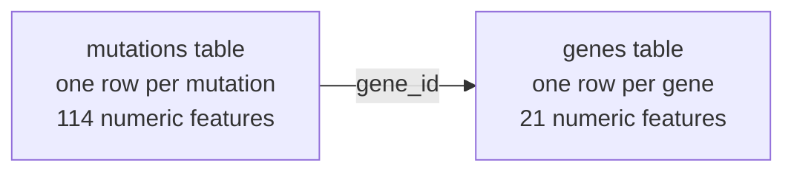

# Can a pretrained "foundation model" for tables match a carefully tuned XGBoost?

*Results so far: 27 October 2026*

## Summary

We compared two very different ways of making predictions from tabular data, on two cancer datasets:

- **NVIDIA Kumo Relational**: a pretrained model that is never trained on our data. It reads the labeled examples and predicts in a single pass.
- **XGBoost**: the standard tool for tabular data. We trained and tuned it as thoroughly as was practical.

**Main finding:** with zero training, Kumo Relational **matched or slightly beat** a thoroughly tuned XGBoost on every comparison. It used a tiny fraction of the compute: seconds instead of hours. The margins are small, about the same size as the normal variation between test splits, so the safe claim is "matches", not "clearly beats".

| Comparison | Kumo Relational | XGBoost (tuned) | Verdict |
|---|---|---|---|
| Breast cancer diagnosis (15 test splits) | AUC 0.997, accuracy 97.8% | AUC 0.995, accuracy 96.7% | Kumo slightly ahead |
| Cancer mutations, 5 test splits (log loss, lower is better) | **0.841** | 0.854 | Kumo slightly ahead (wins 4 of 5 splits) |
| Cancer mutations, separate held-out test set (log loss) | 0.731 | 0.731 | Tie |
| Compute for the 5-split comparison | ~30 seconds on one GPU | ~4,000 CPU-minutes of tuning | Kumo far cheaper |

---

## 1. Background for non-specialists

### What is "tabular data"?

Data arranged in rows and columns, like a spreadsheet. Each **row** is one example (a patient, a genetic mutation). Each **column** is a measured property (a **feature**). One special column is the **label**: the answer we want to predict, such as "malignant or benign".

### What does "training" mean?

A traditional model like XGBoost starts from nothing. It looks at many labeled rows and adjusts itself until it predicts the labels well. This is **training**. Every model also has **hyperparameters**, settings chosen by the user (for example how many decision trees to build). Finding good settings is called **tuning**, and it can take far longer than training itself.

### What is a "foundation model" here?

Large language models like ChatGPT can learn a new task from a few examples written into the prompt, without being retrained. This is called **in-context learning**. Kumo Relational applies the same idea to tables. It was pretrained once by NVIDIA, on a large collection of real and synthetic databases. To use it, you give it:

1. the labeled rows (the "examples"), and
2. the rows you want predictions for,

and it outputs predictions in one pass. **Its internal weights never change, and nothing is trained on our data.**

### How do we measure performance?

We always test on rows the model has not seen labels for. These metrics appear throughout:

| Metric | What it means | Better is |
|---|---|---|
| **Accuracy** | Share of test rows where the model's top guess is correct | Higher |
| **AUC** (area under the ROC curve) | How well the model ranks the right answer above the wrong ones. 0.5 = coin flip, 1.0 = perfect. For several classes we average across classes ("macro AUC"). | Higher |
| **Log loss** | Penalizes confident wrong answers heavily. It rewards predictions that are both correct and *honestly confident*. Guessing evenly among 9 classes scores 2.197. This was the official metric of the Kaggle competition below. | **Lower** |

### Why several "test splits"?

One random train/test split can be lucky or unlucky. **K-fold cross-validation** cuts the data into K parts (folds). Each part takes one turn as the test set while the model learns from the rest, and we average over the K turns. "± x" after a number is the standard deviation across folds, a measure of how much results vary from split to split.

---

## 2. The two models

### XGBoost (gradient-boosted decision trees)

- **What it is:** a decision tree is a flowchart of yes/no questions about the features, for example "is cell radius > 15?". XGBoost builds hundreds of small trees one after another. Each new tree corrects the mistakes of the trees before it. The final prediction combines all of them.
- **Why it's the baseline:** it has been the strongest general-purpose method for tabular data for about a decade, and it wins many data-science competitions.
- **Its weakness:** it learns everything from the dataset in front of it, and it needs tuning to perform at its best.

**How we tuned it, "as well as it can be":**

- **Settings searched:** we used [Optuna](https://optuna.org/), an automatic search tool, over 8 hyperparameters:
  - learning rate
  - tree depth
  - minimum samples per leaf
  - row sampling
  - column sampling
  - three regularization strengths
- **How each candidate was scored:** by 5-fold cross-validation *within the training data only*, stopping the number of trees early once the score stopped improving.
- **Search size:** 100 candidates per test split (50 in an early version).
- **Nested cross-validation:** this whole search was re-run separately inside each test split. The test rows never influenced the chosen settings. Reusing test rows for tuning is a common mistake that makes results look better than they are, and nesting avoids it.

### NVIDIA Kumo Relational (relational foundation model)

- **What it is:** NVIDIA's open-weights version of KumoRFM-2 ([paper](https://arxiv.org/abs/2604.12596), [weights](https://huggingface.co/nvidia/Kumo-Relational)). It is installed with `pip install structured-data-models`.
- **"Relational" means it can read several linked tables at once.** For example, a table of mutations where each mutation points to a row in a table of genes. It doesn't need everything flattened into one big table.

Internally it works in three stages:

1. **Row embedding within each table.** A transformer (the architecture behind modern AI models) turns every row into a list of numbers that summarizes it, comparing it with the other rows in the same table.
2. **Message passing between tables.** A graph neural network passes these summaries along the links between tables. A mutation's summary then also reflects its gene.
3. **In-context prediction.** A second transformer compares each row to be predicted against all the labeled example rows and outputs a probability for each class.

**How we used it:** with NVIDIA's default settings, and **no training and no tuning** in the main comparisons. Its limits, from the package source:

- numeric and date features only
- at most 10 classes
- up to 20,000 labeled examples at once

---

## 3. Dataset 1: Breast cancer diagnosis (a warm-up)

- **Source:** the classic Wisconsin Diagnostic Breast Cancer dataset (built into scikit-learn).
- **Rows:** 569 patients.
- **Features:** 30 numeric measurements of cell nuclei from a biopsy image (radius, texture, smoothness, …).
- **Label:** malignant or benign.
- **Test protocol:** 5-fold cross-validation repeated 3 times with different shuffles = **15 test splits**. Both models saw identical splits.

**Results** (mean ± std over 15 splits):

| Metric | Kumo Relational | XGBoost (nested-CV tuned, 100 candidates per split) |
|---|---|---|
| AUC | **0.9968** ± 0.0034 | 0.9948 ± 0.0044 |
| Accuracy | **0.978** ± 0.012 | 0.967 ± 0.010 |
| Log loss | **0.067** ± 0.031 | 0.085 ± 0.034 |
| Compute (laptop CPU) | ~2 minutes | ~3.5 hours |

**Takeaway:** Kumo is slightly better on all three metrics. But this dataset is easy: both models are near-perfect, so it can't reveal real differences. One percentage point of accuracy is about one patient per test split.

---

## 4. Dataset 2: Classifying cancer mutations (the main test)

### The task

This dataset comes from the 2017 Kaggle competition **"Personalized Medicine: Redefining Cancer Treatment"**, run by Memorial Sloan Kettering Cancer Center. Each row is a **genetic mutation**, described by three things:

- the **gene** it occurs in (e.g. BRCA1, TP53)
- the **variation**, i.e. the specific change (e.g. `Q249E` = the amino acid at position 249 changed from Q to E; or "Truncating Mutations", "Deletion", "Amplification")
- a long **clinical-literature text**: the research article(s) a human expert read to classify it (median about 46,000 characters)

The label is one of **9 classes**, assigned by experts. The competition does not disclose what the classes mean, so we treat them as categories 1–9. The competition's metric was multi-class log loss.

### The data

| Set | Rows | Labels available | Role in our study |
|---|---|---|---|
| Training set | 3,321 | Yes | Examples / training data; 5-fold cross-validation |
| Stage-1 test set (labeled subset) | 368 | Yes (released after the competition) | Separate held-out test, never used for any decision before scoring |
| Stage-2 test set | 986 (125 labeled) | Only 125 rows; this is what the final leaderboard scored | **Not yet used** (kept for a final evaluation) |

Notable properties:

- **Gene sharing:** there are 264 genes. Many mutations share a gene (BRCA1 alone has 264 rows), so knowing the gene is very informative.
- **Article sharing:** there are only 1,920 distinct texts for 3,321 rows. Many mutations are described by the same article.
- **Imbalanced classes:** classes 8, 9 and 3 have only 19, 37 and 89 training rows; class 7 has 953.

### Turning text and names into numbers (shared by both models)

Kumo Relational only accepts numeric features, so we converted everything to numbers once. **Both models received exactly the same information.**

| Feature group | What it captures |
|---|---|
| Text summary (100 columns) | Each article is converted to word-importance scores (TF-IDF), then compressed to 100 numbers (truncated SVD, a standard compression). Similar articles get similar numbers. |
| Mutation type (10 flags) | Is it truncating / deletion / amplification / fusion / overexpression / insertion / frameshift / splice / single-letter substitution / stop codon? |
| Protein position | The number in names like `Q249E` (missing if not applicable) |
| Mention counts | How often the gene name and the variation name appear in the text; text length |
| Gene table | Per gene: number of mutations in the data, and the average text summary of its articles |

**How each model received this:**

- **Kumo Relational** got two linked tables, *mutations* → *genes*.
- **XGBoost** got the same two tables joined into one (each mutation row with its gene's columns appended).



### Result A: 5-fold cross-validation on the training set

Both models were scored on identical splits. XGBoost was nested-CV tuned with 100 candidates per split.

| Split | Kumo Relational log loss | XGBoost log loss |
|---|---|---|
| 1 | **0.819** | 0.839 |
| 2 | **0.843** | 0.877 |
| 3 | 0.906 | **0.881** |
| 4 | **0.853** | 0.871 |
| 5 | **0.784** | 0.801 |
| **Mean ± std** | **0.841** ± 0.045 | 0.854 ± 0.034 |

| Other metrics (mean) | Kumo Relational | XGBoost |
|---|---|---|
| Accuracy | 0.694 | **0.703** |
| Macro AUC | **0.932** | 0.926 |

**Takeaway:** Kumo has the better log loss (wins 4 of 5 splits) and AUC; XGBoost is slightly more often exactly right (accuracy). The differences are smaller than the split-to-split variation, so in practice it's a tie, at a fraction of the cost.

### Result B: learn from the full training set, test on the separate stage-1 set (368 rows)

This is the most realistic test: the stage-1 rows are entirely separate data that played no part in any choice we made. XGBoost was tuned with 100 candidates by cross-validation on the training set only.

| | Log loss | Accuracy | Macro AUC |
|---|---|---|---|
| Reference: guess 1/9 for every class | 2.197 | – | – |
| Reference: always predict the training class frequencies | 1.819 | – | – |
| **Kumo Relational** | **0.731** | 0.723 | 0.920 |
| **XGBoost (tuned)** | **0.731** | **0.731** | **0.938** |

**Takeaway:** a tie on the competition's metric. XGBoost ranks classes slightly better (AUC), but with 368 test rows, differences of 0.01–0.02 are within noise.

Kumo's results vary by about ±0.001 between runs because of internal random shuffling. The same configuration gave 0.730 on a laptop and 0.731 on the GPU.

### Compute cost

| | Kumo Relational | XGBoost |
|---|---|---|
| Training | None | Required |
| Tuning | None | 100 candidates × 5 inner folds per split |
| 5-split comparison, wall time | ~20 seconds (one NVIDIA A100 GPU) | 46 minutes on 30 CPU cores (≈ 4,000 CPU-minutes) |
| Stage-1 comparison, wall time | ~10 seconds | 33 minutes |

### Can Kumo be improved with its own settings? (a small tuning sweep)

To be fair to Kumo, we also tried a few of its settings, choosing only by cross-validation on the training set:

| Link steps followed | Other mutations of the same gene included | Ensemble size | Log loss (5-fold CV) |
|---|---|---|---|
| 1 (mutation → its gene) | – | 32 | **0.843** |
| 1 | – | 8 (default) | 0.846 |
| 2 (also the gene's other mutations) | 20 | 32 | 0.904 |
| 2 | 5 | 8 | 0.918 |

**Takeaway:** the defaults are already near-best. Adding the gene's other mutations *hurts*. Their features add noise, and the model cannot see their labels: labels are only attached to the row being predicted.

---

## 5. How this compares to the Kaggle leaderboard (and why it doesn't directly)

The final leaderboard was scored on the 125 labeled stage-2 rows:

| Final leaderboard | Log loss |
|---|---|
| 1st place | 2.030 |
| 2nd–6th place | 2.09–2.14 |
| Guessing 1/9 for every class | 2.197 |

Only 14 teams beat even guessing. Our scores (0.73–0.85) are far lower, **but they are not comparable**, because the leaderboard set's class mix is very different from the training data:

| Class | Training set | Stage-1 set | Stage-2 (leaderboard) set |
|---|---|---|---|
| 1 | 17% | 26% | 4% |
| 2 | 14% | 13% | **42%** |
| 7 | 29% | 27% | **4%** |
| 8 | **0.6%** | 0.5% | **26%** |

A model trained on data where class 8 is almost absent will be confidently wrong about the leaderboard set, and log loss punishes that heavily. Evaluating on the stage-2 set is planned as a separate, final step.

---

## 6. Caveats: what could make these results misleading

1. **Small margins.** The differences between models are about the size of the variation between test splits. "Matches" is supported; "beats" is not yet.
2. **Shared articles across splits.** Many mutations share an article, so a test row's article may also appear in training. This likely flatters both models' cross-validation scores equally.
3. **Text compression saw all texts.** The text summary was fitted on all article texts, including test rows (but never their labels). Competitors could do the same, since test texts were provided.
4. **XGBoost's tuning budget.** We stopped at 100 candidates. More search might add a little, but scores were already stable across splits.
5. **Small test sets.** 368 stage-1 rows and 125 stage-2 rows mean individual results carry real uncertainty.
6. **We looked at the stage-2 class mix once.** We looked at it (Section 5) but have not used it for any modeling choice.

---

## 7. What's next

| Idea | Why |
|---|---|
| **Learning curve:** train/test both models with 100, 300, 1,000 and all training rows, and look at rare classes | Kumo's pretraining should help most when examples are scarce. This is its most likely genuine advantage. |
| **Shared-label features for both models:** for each mutation, the class mix of *other* training mutations with the same article or gene (excluding itself) | Probably a strong signal for both; given to both models to keep the comparison fair |
| **Adjust for the leaderboard's different class mix** using the unlabeled stage-2 rows (no labels needed) | Needed to compete on the leaderboard metric |
| **Final, one-time evaluation on the stage-2 leaderboard set** | The first number directly comparable to the leaderboard |
| **Fine-tuning Kumo** | NVIDIA reports further gains, but it isn't known yet whether the package supports it |

---

## 8. How to reproduce

All code is in this repository.

| File | Purpose |
|---|---|
| `setup_env.sh` | Creates the `gfm` conda environment (macOS CPU, or Linux with an NVIDIA GPU) |
| `cancer_data.py`, `cancer_rfm.py`, `cancer_xgb.py` | Breast cancer: shared splits, Kumo, XGBoost |
| `msk_data.py` | Mutation data: builds and caches the features; shared splits and metrics |
| `msk_rfm.py`, `msk_xgb.py` | Mutation data, 5-fold comparison |
| `msk_rfm_eval.py`, `msk_xgb_eval.py` | Mutation data, training set → stage-1 comparison |
| `msk_graph.py`, `msk_rfm_sweep.py` | Kumo setting sweep (per-mutation neighborhoods) |
| `run_lambda.sh`, `run_xgb_folds.sh` | Run everything on a GPU cloud machine; XGBoost folds in parallel |

The mutation data must be downloaded from Kaggle after accepting the competition rules:

```bash
kaggle competitions download -c msk-redefining-cancer-treatment -p data/msk
```

**Environment:**

- **Models:** `structured-data-models` 0.2.1, PyTorch 2.14, XGBoost 3.4.2, Optuna.
- **Hardware:**
  - Apple M5 Pro laptop (CPU) for the breast cancer comparison.
  - Lambda Labs 1× NVIDIA A100 40 GB with 30 CPU cores for the mutation-data runs.
